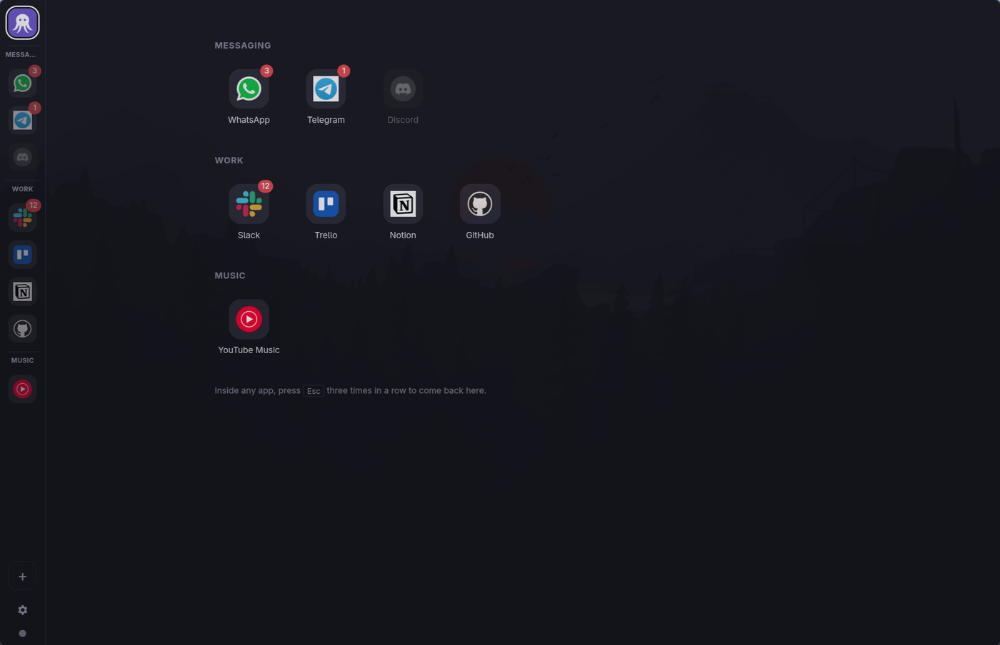
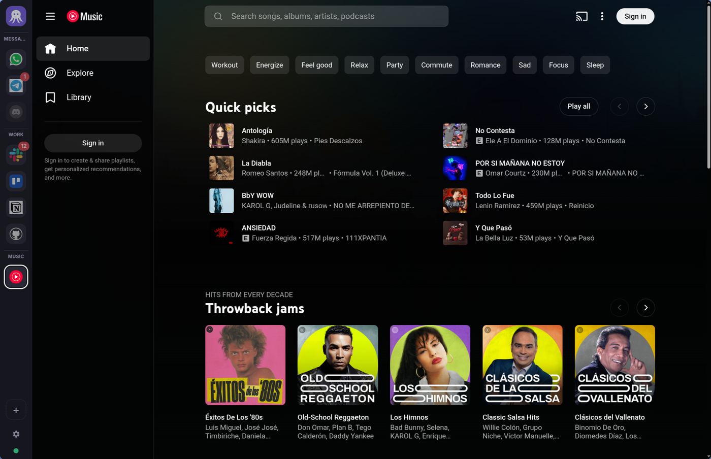
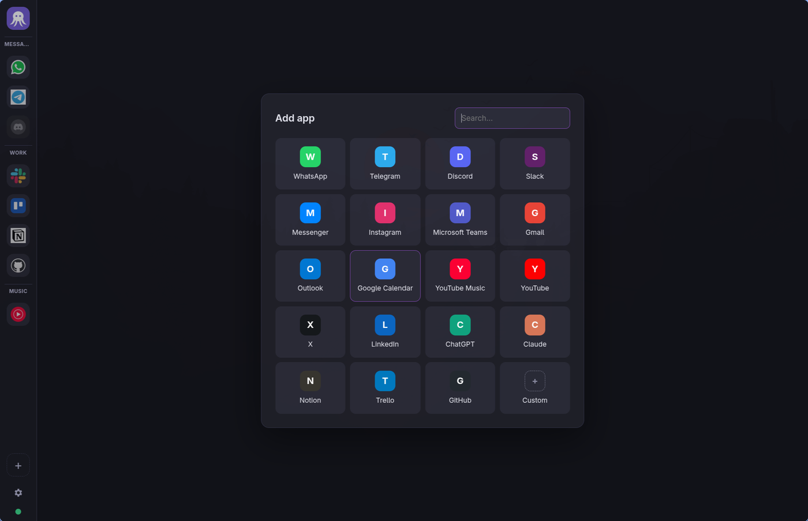
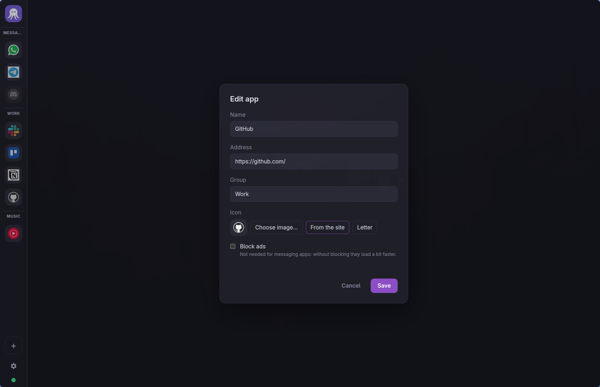

<p align="center">
  
</p>

<h1 align="center">Pulpo</h1>

<p align="center">
  All your web apps in one window, without ads.<br />
  Built with Rust and Tauri for Linux and Windows, with Brave's ad-blocking engine.
</p>

<p align="center">
  
</p>

---

Pulpo puts WhatsApp, Telegram, Slack, YouTube Music or any other web app in a
single window with a sidebar, like Rambox, but without Electron or Node.js.
The app itself is Rust ([Tauri 3](https://v3.tauri.app)) and the web apps run
in Chromium, so they feel as fast as in a browser. Each app gets its own
session, and ads are blocked with the same engine and filter lists as Brave.

## Highlights

- **Any web app.** Pick one from the built-in catalog (WhatsApp, Telegram,
  Discord, Slack, Messenger, Instagram, Teams, Gmail, Outlook, Google
  Calendar, YouTube Music, YouTube, X, LinkedIn, ChatGPT, Claude, Notion,
  Trello, GitHub) or add any address you like.
- **Ad blocking per app.** Brave's engine
  ([adblock-rust](https://github.com/brave/adblock-rust)) with the uBlock
  Origin, EasyList, EasyPrivacy and Brave lists, including the uBO scriptlets
  that remove YouTube ads. Turn it off for apps that don't need it (like
  messaging apps) and they load a bit faster.
- **Home page.** Every app at a glance, grouped, with unread counters. Press
  <kbd>Esc</kbd> three times inside any app to get back to it.
- **One app on the home page.** Optionally pick one app to show in the bottom
  half of the home page (⚙ → *App on the home page*, or right-click → *Show on
  home page*). It's the app itself, not a copy: open it from its button and
  you're on the same page, full size. Drag the bar between them to resize it
  (double-click: back to half); Pulpo remembers the size.
- **Groups and your own order.** Put apps in groups (Work, Personal…),
  collapse them, and drag icons to reorder them.
- **Your icons.** The site's own icon is downloaded automatically; you can also
  pick any image or just use a colored letter.
- **Disable without removing.** A disabled app is fully closed: it doesn't
  load, use memory or get notifications until you enable it again.
- **Separate sessions.** Each app has its own profile (cookies, logins,
  cache). Google, Apple, Microsoft or GitHub sign-in pop-ups open inside Pulpo
  so logins complete in the right app.
- **Rambox-style shortcuts** that also work while you're typing inside an app.
- **Notifications take you there.** Clicking an app's notification brings
  Pulpo to the front with that app open.
- **Right size on every screen.** On Linux with Hyprland's
  `xwayland:force_zero_scaling` (Omarchy), Pulpo applies each screen's scale
  itself and switches it when you move the window between screens.
- **English, Português, Español.**

<p align="center">
  
</p>

<table>
  <tr>
    <td></td>
    <td></td>
  </tr>
  <tr>
    <td align="center">Add an app from the catalog or any address</td>
    <td align="center">Name, address, group, icon and ad blocking per app</td>
  </tr>
  <tr>
    <td></td>
    <td></td>
  </tr>
  <tr>
    <td align="center">Right-click an app for quick actions</td>
    <td></td>
  </tr>
</table>

## Keyboard shortcuts

They work from the sidebar and also with the focus inside an app.

| Shortcut | Action |
| --- | --- |
| <kbd>Ctrl</kbd> <kbd>Ctrl</kbd> (tap twice) | Switch between the last two apps |
| <kbd>Ctrl</kbd>+<kbd>1</kbd> … <kbd>Ctrl</kbd>+<kbd>9</kbd> | Go to the app at that position in the sidebar |
| <kbd>Ctrl</kbd>+<kbd>Space</kbd> | Quick switcher: type to filter your apps, <kbd>Enter</kbd> to open one |
| <kbd>Esc</kbd> <kbd>Esc</kbd> <kbd>Esc</kbd> | Home page |
| <kbd>Ctrl</kbd>+<kbd>+</kbd> / <kbd>Ctrl</kbd>+<kbd>-</kbd> / <kbd>Ctrl</kbd>+<kbd>0</kbd> | Bigger / smaller / automatic size on this screen (sidebar focused) |
| Middle click on an icon | Reload the app |

## Managing apps

- **+** adds an app; **⚙** opens *Manage apps* (edit, enable/disable, remove,
  move up/down, screen size, language). Right-clicking an icon gives the same
  options.
- **Order and groups**: drag icons in the sidebar (dropping one on a group
  title moves it into that group), use ↑/↓ in *Manage apps*, or edit
  `~/.local/share/com.pulpo.app/services.json` while Pulpo is closed: the file
  order is the sidebar order and `"group"` groups apps (apps without a group
  go first).
- **Removing** an app also deletes its session and data.
- **Links** that open a new window go to your default browser, except sign-in
  pop-ups, which stay in Pulpo.

## Install

Download the latest release from
[Releases](https://github.com/eitalouarruda/pulpo/releases/latest):

- **Linux**: `Pulpo_<version>_amd64.AppImage`. Make it executable and run it,
  or open it with AppImageLauncher / Gear Lever to integrate it into your
  menu. It bundles its own Chromium, so it works on any recent distro.
- **Windows**: `Pulpo_<version>_x64-setup.exe` (or the `.msi`). It uses
  WebView2, which already comes with Windows.

**Updates.** When Pulpo starts it checks the latest GitHub release and, if
there's a newer one, asks before doing anything. If you say yes it downloads
it and restarts on the new version: the AppImage replaces itself (only one
file is left, and AppImageLauncher's menu entry follows it); on Windows the
installer runs in passive mode and keeps your data.

## How ad blocking works

Lists are downloaded at startup and refreshed once a day
(`~/.cache/com.pulpo.app/filter-lists`).

| Layer | Linux (CEF) | Windows (WebView2) |
| --- | --- | --- |
| Network (requests to ad and tracker domains) | DevTools Protocol `Fetch` domain + Brave's engine for every request | `WebResourceRequested` + Brave's engine for every request |
| Cosmetic (hide ad elements) | CSS injected at the start of every document | same |
| uBO scriptlets (`+js(...)`) | Injected at the start of every document | same |

YouTube ads can't be blocked by URL because they come inside the player
responses; the uBlock Origin scriptlets (`json-prune`, `set-constant`, …)
remove them, just like in Brave. They are generated from uBO's source with:

```sh
pnpm update-ubo        # or: node scripts/update-ubo-resources.mjs <tag>
```

## Why Chromium on Linux

Tauri normally uses the system web view, which on Linux is WebKitGTK. In
benchmarks navigating YouTube Music it was about 3× slower than Chromium, so
Pulpo uses Tauri 3's CEF runtime on Linux. On Windows WebView2 is already
Chromium.

On Linux Pulpo runs through XWayland. With Hyprland and
`xwayland:force_zero_scaling = true`, X11 apps aren't scaled, so Pulpo asks
Hyprland for the scale of the screen the window is on and applies it as zoom
(e.g. 160 % on a laptop at 1.6). You can override it per screen; it's stored
in `settings.json`.

## Development

Requirements: Rust, Node.js with pnpm, and on Linux GTK 4.12+, CMake and
Ninja (the Chromium/CEF distribution is downloaded on the first build, about
1 GB).

```sh
./dev.sh               # pnpm install if needed, then tauri dev
./dev.sh --update-ubo  # regenerate the uBlock Origin scriptlets first
./dev.sh --bench       # YouTube Music navigation benchmark
```

See what the blocker would do on a page, with the real lists:

```sh
cd src-tauri
cargo run --release -p blocker --example inspect --features content-blocking -- https://music.youtube.com/
```

Every push to `main` builds and publishes a GitHub release with the AppImage
(built on Arch and smoke-tested on Ubuntu before publishing) and the Windows
installers.

## Licenses

`src-tauri/crates/blocker/resources/ubo-resources.json` contains uBlock
Origin's scriptlets (GPL-3.0). adblock-rust is MPL-2.0.
